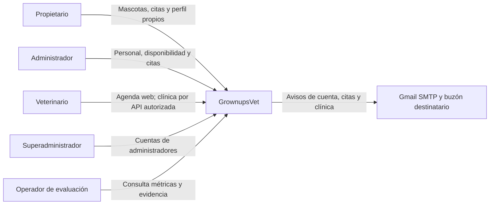
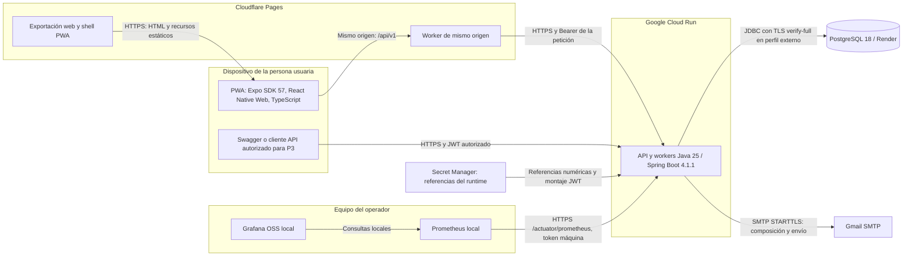

# Arquitectura del alcance parcial de auditoría

**Corte de hoy: 26 de octubre de 2026, America/Bogota.** Describe P1/P2 web
y P3 API publicado/verificado, más los cambios verificables del incremento
de auditoría identificados como tales. No es una entrega final completa.
La auditoría integral debe esperar la finalización de la versión final.

Estas vistas de contexto, contenedores y componentes actualizan la lectura
técnica del corte. No sustituyen la aprobación del C4 académico compartido
ni afirman que el equipo haya revisado o aceptado este documento. El
[expediente](expediente-auditoria-2026-10-26.md) conserva la matriz de auditoría;
el [manual por roles](manual-usuario-auditoria-2026-10-26.md) contiene el uso
de la interfaz. El [modelo de BD](auditoria-base-datos.md) evita repetir aquí
el diccionario y ER completo.

## Fuente y frontera del corte

| Fuente | Qué representa |
|---|---|
| [Backend remoto base 7368058](https://github.com/Estebangmz666/grownupsvet-backend/tree/736805879fcb6ffe968242d0647439fbe0ddf3f6) | Implementación de API P1–P3 y observabilidad; contrato desplegado de partida 0.10.0, 47 rutas, V1–V22. |
| [Frontend remoto base 492c71f](https://github.com/Estebangmz666/grownupsvet-frontend/tree/492c71fc152ddeda55e34df808d0f132cd361dc7) | Aplicación web común, vistas P1/P2 por cuatro roles y compatibilidad con COMPLETED. |
| Incremento de auditoría del 26/10 | Admisión de login/contrato 0.11.0/V23, adaptación 429 del cliente y helper conservador. Código y verificación local/CI se distinguen de su publicación y activación. |
| [Swagger/OpenAPI públicos](https://grownupsvet-backend-w5glrcsyda-uc.a.run.app/v3/api-docs) | Se deben consultar al cerrar la demostración; un cambio de código no modifica por sí solo el contrato desplegado. |

El cierre añadirá los SHAs nuevos y revisión/digest publicados. No atribuir
0.11.0 ni la activación del límite de login al servicio antes de verificarlo.
No hay UI clínica completa, adendas ni aceptación Android/iOS en este corte.

## C4 nivel 1: contexto



Los roles son responsabilidades independientes. SUPER_ADMIN no hereda las
competencias administrativas ni clínicas; ADMINISTRATOR gestiona citas sin
obtener por ello contenido clínico. Un rol de aplicación tampoco representa
por sí solo un stakeholder, revisor o responsable académico.

## C4 nivel 2: contenedores y conexiones



La PWA, la exportación y el worker pertenecen al mismo producto web; no son
dos aplicaciones en ejecución ni dos accesos por rol. El navegador consume
`/api/v1` del mismo origen. El gateway reenvía a Cloud Run y no reemplaza la
autorización del backend. No se requiere abrir CORS directo para este
recorrido; Swagger y clientes API autorizados son entradas técnicas
separadas, no una UI clínica del frontend.

El gateway fuerza `no-store` en API, elimina cookies y cabeceras de origen
del navegador y reconstruye forwarding según su política. Eso no convierte
un header en identidad humana confiable: la admisión PEER del incremento
nuevo ignora forwarding no verificado y puede agrupar conexiones de
proxy/NAT. El service worker conserva shell/estáticos admitidos, no API,
credenciales, respuestas privadas ni tokens de activación.

Cloud Run conserva CPU fuera de peticiones para los workers, la identidad
de ejecución y su límite de servicio. Un cap de servicio 1 puede coexistir
con cap histórico de revisión 20; el helper distingue ambos y los preserva.
La política y el presupuesto existentes no se reconstruyen desde una
plantilla anterior. Consultar [despliegue](google-cloud.md) para los controles
de actualización por imagen y sus límites.

Prometheus/Grafana son locales, no sidecars ni un almacén de métricas nuevo
en nube. Sin computador/procesos activos no constituyen vigilancia continua.
El backend conserva solo el hash de la credencial máquina; el Bearer
original queda en el archivo privado del recolector. No es un JWT humano
y no concede acceso a la API de negocio. Véase [observabilidad](observabilidad.md).

## C4 nivel 3: componentes verificables

| Componente | Responsabilidad y vínculo a fuentes |
|---|---|
| Navegación raíz y áreas | El frontend [src/navigation](https://github.com/Estebangmz666/grownupsvet-frontend/tree/492c71fc152ddeda55e34df808d0f132cd361dc7/src/navigation) dirige al área permitida; `apps/propietario` y `apps/administrativo` separan pantallas dentro del mismo runtime. |
| Autenticación y cliente compartidos | [packages](https://github.com/Estebangmz666/grownupsvet-frontend/tree/492c71fc152ddeda55e34df808d0f132cd361dc7/packages): almacenamiento de sesión, generación/cancelación de solicitudes, HTTP tipado y accesibilidad reutilizable. |
| Entrada HTTP y seguridad | [authentication](../src/main/java/edu/uniquindio/grownupsvet/grownupsvet_backend/authentication) y [shared/configuration](../src/main/java/edu/uniquindio/grownupsvet/grownupsvet_backend/shared/configuration): acceso, JWT, revocación, permisos y cadenas de seguridad. |
| Usuarios y mascotas | [user](../src/main/java/edu/uniquindio/grownupsvet/grownupsvet_backend/user), [pet](../src/main/java/edu/uniquindio/grownupsvet/grownupsvet_backend/pet): registro/perfil/foto y recursos ligados al propietario. |
| Personal y agenda | [staff](../src/main/java/edu/uniquindio/grownupsvet/grownupsvet_backend/staff), [availability](../src/main/java/edu/uniquindio/grownupsvet/grownupsvet_backend/availability), [appointment](../src/main/java/edu/uniquindio/grownupsvet/grownupsvet_backend/appointment): roles profesionales, invitaciones/diplomas, turnos, citas, cambios, versiones, historial y avisos. |
| Clínica API | [clinical](../src/main/java/edu/uniquindio/grownupsvet/grownupsvet_backend/clinical): borradores, tratamiento, finalización, historia autorizada y programaciones/cola de recordatorios. |
| Correo | [shared/email](../src/main/java/edu/uniquindio/grownupsvet/grownupsvet_backend/shared/email) compone representaciones HTML/texto; outboxes/workers de cada dominio conservan vigencia, leases e intentos. |
| Persistencia e invariantes | [Flyway](../src/main/resources/db/migration) y repositorios: relaciones, restricciones, bloqueo y transacciones. V23 pertenece al incremento de admisión; no se infiere su despliegue por existir el archivo. |
| Métricas y operación | [shared/observability](../src/main/java/edu/uniquindio/grownupsvet/grownupsvet_backend/shared/observability), perfiles de gestión y [scripts/observability](../scripts/observability): contadores posteriores al commit y scrape separado de sesiones humanas. |

Los dominios contienen controladores, DTOs, servicios y repositorios.
El contrato se genera desde Java y se contrasta con HTTP/OpenAPI; no se
modifica manualmente el snapshot para fingir una capacidad. Este documento
identifica responsabilidades, no demuestra por sí solo bajo acoplamiento,+cobertura total ni capacidad de carga general.

## Flujo de autenticación y autorización

```mermaid
sequenceDiagram
    actor Person as Persona usuaria
    participant Web as Web y gateway
    participant API as API
    participant Admission as Admisión opcional I4
    participant DB as PostgreSQL
    Person->>Web: Correo y contraseña
    Web->>API: POST /api/v1/auth/sessions
    opt I4 publicado y habilitado
        API->>Admission: Correo normalizado y peer de transporte
        Admission->>DB: Transacción corta: bloquear y consumir cupos HMAC
        DB-->>Admission: Admitido o espera temporal
        Admission-->>API: Decisión confirmada antes de Argon2
    end
    alt Admisión agotada
        API-->>Web: 429 genérico y Retry-After; sin verificar contraseña
    else Admisión permitida o política deshabilitada
        API->>DB: Consultar cuenta
        Note over API: Argon2, estado activo y emisión JWT RS256
        API-->>Web: JWT, identidad, rol y permisos
    end
    Person->>Web: Consultar o cambiar recurso permitido
    Web->>API: Petición con Bearer
    API->>DB: Estado, rol/permisos vigentes, revocación y recurso
    Note over API,DB: Firma, emisor, audiencia y vencimiento se validan; la propiedad/asignación decide visibilidad
    API-->>Web: Recurso autorizado o error Problem Details
```

Las contraseñas se almacenan con Argon2id; el login también verifica un hash
dummy para correo desconocido. JWT RS256 tiene duración de 24 horas, sin
refresh token; cada petición protegida valida cuenta, estado, rol, permisos
y revocación en PostgreSQL. Logout revoca la sesión. Los permisos del cliente
permiten orientar la navegación, pero el servidor comprueba cada operación
y su recurso. Detalles en [usuarios/permisos](arquitectura-usuarios-y-permisos.md).

La sesión web usa `sessionStorage`, con respaldo en memoria si no está
disponible. No es un almacén cifrado ni inmune a XSS. Al recargar se valida
la sesión antes de mostrar recursos privados; la fecha absoluta no se
extiende. Respuestas antiguas se descartan por contexto/generación al cambiar
de cuenta. El almacenamiento nativo previsto usa SecureStore; eso no
acredita aceptación Android/iOS.

La [admisión de login](login-admission.md) nueva usa HMAC y PostgreSQL, no
correo/IP en claro en los contadores. Por omisión está deshabilitada hasta
configurar y verificar el entorno. Cuando está activa, `REQUIRES_NEW`
confirma la admisión antes del lookup/Argon2 y no hay bypass si falla la BD.
El 429 no informa existencia/estado de cuenta. Es una cuota por peer y
correo+peer, no un bloqueo permanente ni un límite global de cuenta entre
peers. Su activación desplegada requiere evidencia propia.

## Consistencia clínica, correo y evidencia

Una atención se vincula a su cita, mascota, propietario y responsable.
Textos/tratamiento comparten versión. La finalización autorizada desde el
inicio real produce FINALIZED y COMPLETED en un único commit, con eventos y
programaciones; los registros finalizados y sus hijos son inmutables.
La historia publica únicamente finalizados y aplica propiedad/asignación a
listados, totales, detalle y tratamiento. Administración de citas no concede
lectura clínica. Véase [contrato clínico](atenciones-clinicas.md).

Los cambios idempotentes conservan clave e intención. Un replay devuelve
estado vigente sin repetir su escritura; ese estado puede incluir cambios
posteriores. Una respuesta perdida no prueba éxito ni fallo: la web bloquea
otro envío y ofrece reconciliar. Consultar estado no identifica por sí solo
qué intento escribió. No todas las altas tienen la misma garantía de replay.

Correo usa tareas durables y revalidación antes del transporte, con SMTP
fuera de transacción. La aceptación SMTP no confirma llegada al buzón ni
lectura. Los recordatorios clínicos omiten vencidos y tienen garantía de al
menos una vez dentro de su ventana; una confirmación perdida puede dejar un
duplicado incierto. No se promete exactamente una entrega.

Los contadores de commits y los histogramas apoyan observación; no son
auditoría durable ni reemplazan oráculos de persistencia, denominadores o
muestras de M1–M9. Backups/restauración y base aislada de evaluación conservan
sus [procedimientos](respaldo-render.md) y [verificaciones](auditoria-base-datos.md).
Pruebas locales, CI, despliegue, aceptación funcional y aceptación humana
son evidencias separadas.

## Mantenimiento y revisión

Si cambian entradas, roles, perfiles o conexiones, actualizar esta vista y
el manual y contrastar nuevamente las fuentes. Antes de utilizarla como
evidencia compartida, registrar revisor real, fecha, SHA publicados,
revisión/digest, contrato y observaciones. La revisión de la arquitectura
académica, privacidad aplicable y sesiones con personas mayores/lector de
pantalla siguen pendientes hasta obtener su soporte; este texto no los
declara aprobados.
