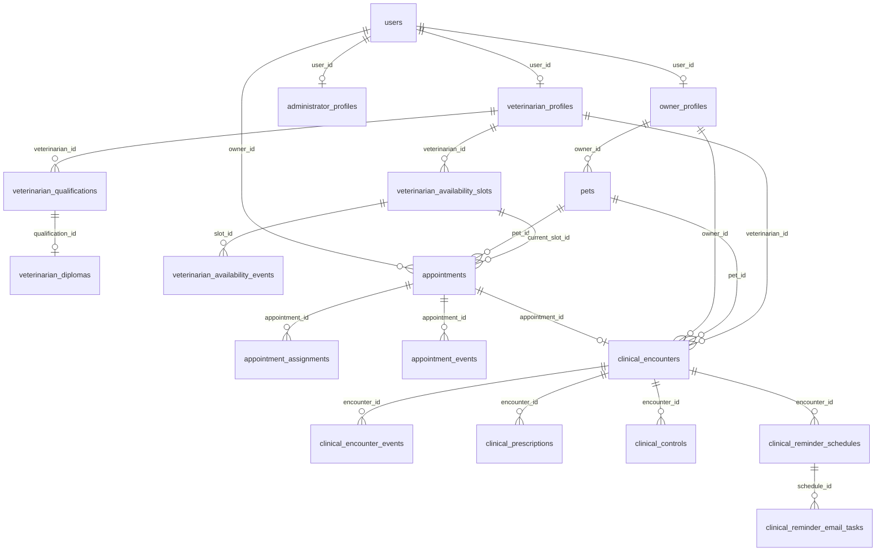

# Base de datos aislada para la auditoría

**Corte: 26 de octubre de 2026, America/Bogota. Alcance parcial del incremento de fortalecimiento.** Este kit y su prueba local no constituyen una auditoría final del proyecto. El esquema evaluado incluye V1–V23, publicadas en el [commit 960c8898](https://github.com/Estebangmz666/grownupsvet-backend/commit/960c8898acbb22a227eac9424260a12936556227). La reproducción local de este kit y el despliegue productivo tienen evidencias separadas en el [expediente del corte](expediente-auditoria-2026-10-26.md).

El kit de `scripts/audit-database` reconstruye **dos bases nuevas de PostgreSQL 18 local** desde las fuentes Flyway del checkout identificado. Una sirve para inspección mediante vistas de lectura; la otra permite ensayar escrituras y restricciones. Nunca utiliza `DB_URL`, Render, `grownupsvet_dev` ni `grownupsvet_test` como destino. No arranca Spring, procesos de correo ni SMTP.

Su propósito es explicar el modelo, integridad y permisos con datos ficticios. Las filas iniciales se cargan directamente en SQL: **no acreditan aceptación REST, interfaz, idempotencia de la API ni envío de correo**. La aceptación del sitio desplegado y las pruebas automáticas del backend conservan sus evidencias separadas.

Los fixtures representan relaciones disponibles en la API de usuarios, mascotas, agenda/citas y borrador clínico. No implementan interfaz clínica ni cierran sus casos de comprensión o aceptación. La auditoría integral del proyecto se realizará cuando concluya el alcance previsto; aquí se registra únicamente el estado y evidencia de este incremento al corte indicado.

## Creación en Windows

Requisitos: PostgreSQL 18 local, Java 25, PowerShell 7.4 y acceso a las dependencias Maven. El usuario local de aprovisionamiento necesita `CREATEDB` y `CREATEROLE` o permisos equivalentes. Esos privilegios no se conceden al auditor.

Desde la raíz del backend, disponer de `DB_USERNAME` y `DB_PASSWORD` **del servidor local** en el proceso. No colocar sus valores en instrucciones compartidas, argumentos o archivos del repositorio. El puerto predeterminado es 5432; solo se aceptan `127.0.0.1`, `localhost` o `::1`, y el servidor efectivo se comprueba otra vez mediante JDBC.

```powershell
# Solo valida parámetros e inventario; no conecta a una base.
./scripts/audit-database/New-AuditDatabase.ps1

# Crea nombres UUID nuevos, migra, carga fixtures y verifica permisos/integridad.
./scripts/audit-database/New-AuditDatabase.ps1 -Execute
```

Para repetir sin ejecutar Maven mientras hay una regresión en curso, `-ResolvedClasspathFile` permite reutilizar el `classpath.txt` privado de una ejecución anterior del mismo checkout y dependencias. Solo acepta rutas absolutas a JAR existentes. No reutilizarlo después de cambiar dependencias; ese archivo no se comparte como credencial ni se edita para añadir bibliotecas ajenas.

Se crea un directorio privado `%USERPROFILE%/.grownupsvet/audit-database/<RunId>`, fuera de Git y sin enlaces de redirección. Su ACL permite únicamente al usuario Windows actual y SYSTEM. Contiene:

- `credentials.clixml`: contraseñas aleatorias de lector, escritor y cuentas ficticias cifradas con DPAPI; solo la misma cuenta Windows puede importarlas.
- `report-sanitized.json`: nombres de bases/roles, cantidad de migraciones y comprobaciones, sin contraseñas.
- `schema-sanitized.json`: tablas, columnas y constraints consultados del catálogo real después de Flyway, sin filas ni secretos.
- Logs privados del aprovisionamiento y resolución de dependencias. No adjuntarlos automáticamente al expediente público.

Cada ejecución usa nombres nuevos y se detiene si ya existen. No reutiliza ni borra bases para conseguir un resultado verde. Ante un fallo parcial, conservar el RunId y consultar la etapa saneada; la eliminación explícita descrita más adelante permite retirar solo los recursos propios.

## Qué se entrega al auditor

| Recurso | Permiso y contenido |
| --- | --- |
| `grownupsvet_audit_<RunId>` | Base principal, propiedad del aprovisionador local. Lector con `CONNECT`, `USAGE` en `audit_review` y `SELECT` en sus vistas. Sin escritura ni lectura directa de tablas de credenciales. |
| `gv_audit_reader_<RunId>` | Login sin superusuario, creación de bases/roles, replicación ni bypass RLS. `default_transaction_read_only=on` es una protección adicional: las escrituras también se deniegan si el lector la desactiva. |
| `grownupsvet_audit_write_<RunId>` | Copia independiente con las mismas migraciones/fixtures. Su escritor recibe DML en tablas, sin propiedad, creación de esquema ni edición del historial Flyway. |
| `gv_audit_writer_<RunId>` | Rol limitado a los permisos explícitos anteriores; sus ensayos no afectan la base principal ni producción. PostgreSQL puede conceder conexión a otras bases mediante `PUBLIC`: el kit no modifica esas bases compartidas ni concede acceso a sus tablas. |

El esquema `audit_review` expone cuentas sin `password_hash`, perfiles, mascotas, títulos sin el binario del diploma, disponibilidad/eventos, citas/asignaciones/eventos, borradores/eventos clínicos, fórmulas/controles y versiones Flyway. No expone OTP, claves de contadores HMAC, tokens revocados, invitaciones, cuerpos/cifrados de correo, fotos o archivos privados. Esto es una cuenta de auditoría de datos ficticios; no es un rol del producto ni una forma de consultar datos reales de usuarios.

La conexión puede abrirse con pgAdmin o `psql`, usando el host/puerto/nombre de usuario del reporte y la contraseña entregada por un canal privado. DPAPI no es un formato de intercambio entre compañeros: **en otro computador se ejecuta el kit y se generan credenciales nuevas**. Para consultar localmente sin poner la contraseña en argumentos, `psql --password` la solicita de forma interactiva:

```powershell
# Sustituir los dos identificadores por los del reporte de esta ejecución.
psql --host=127.0.0.1 --port=5432 --dbname=grownupsvet_audit_RUNID --username=gv_audit_reader_RUNID --password --no-psqlrc
```

```sql
SELECT * FROM audit_review.migrations ORDER BY installed_rank;
SELECT id, email, role, status FROM audit_review.accounts;
SELECT id, name, species, owner_id FROM audit_review.pets;
SELECT id, status, pet_id, current_slot_id FROM audit_review.appointments;
SELECT id, status, appointment_id, veterinarian_id FROM audit_review.clinical_encounters;
```

Los cuatro correos sintéticos son `super_admin@audit.example.com`, `administrator@audit.example.com`, `veterinarian@audit.example.com` y `owner@audit.example.com`. Sus contraseñas aleatorias se guardan únicamente en DPAPI; los nombres y la matrícula indican que son fixtures. Hay una mascota, un turno futuro, una cita confirmada y un borrador clínico sin finalidad asistencial. No hay tareas SMTP programadas.

No iniciar la aplicación contra estas bases con variables SMTP de producción heredadas. Para ampliar datos mediante REST, seguir [datos-demostracion.md](datos-demostracion.md) y [ejecucion-local.md](ejecucion-local.md) en un servidor local dedicado, con JWT locales, recuperación/invitaciones deshabilitadas y SMTP de pruebas sin salida externa. El kit no configura ni acredita ese arranque web: requiere su comprobación explícita antes de demostrarlo.

## Modelo entidad-relación esencial

Derivado de las claves foráneas de V1–V22 y del esquema aplicado. La migración V23 agrega contadores de login independientes, sin nuevas relaciones de negocio. Las relaciones de actores (`created_by`, `updated_by`, auditorías y versiones anteriores) se describen en el diccionario/exportación y se omiten aquí para facilitar lectura. `appointments.owner_id` referencia físicamente `users`, mientras `pets.owner_id` y `clinical_encounters.owner_id` referencian `owner_profiles`.



Un turno puede tener varias citas históricas; el índice parcial impide más de una reserva activa. La relación de atención con cita es única. Las claves compuestas de programación a fórmula/control comprueban que ambos pertenezcan a la misma atención; consultar su definición exacta en el catálogo exportado.

## Diccionario breve y reglas que se pueden defender

| Grupo/tablas | Identidad y finalidad | Integridad relevante |
| --- | --- | --- |
| `users`, perfiles de propietario/administrador/veterinario | UUID de cuenta; perfiles 1:0..1 por `user_id` | Correo normalizado único, roles/estados admitidos, único superadministrador; propietario y cuenta activa requieren credencial. El perfil personal del propietario no se inventa para otros roles. |
| `pets` | UUID, dueño, especie, nacimiento opcional, archivo lógico | FK a perfil propietario; especie/sexo permitidos; nacimiento estimado requiere fecha; índices por dueño/estado. Fechas futuras se validan con reloj de aplicación, no por CHECK SQL dependiente de hoy. |
| Títulos y diplomas | UUID de título y binario por `qualification_id` | Matrícula profesional única, título base único por veterinario y de pregrado; tamaño del PDF coherente con bytes. Autenticidad profesional/legibilidad no se certifica mediante FK. |
| Disponibilidad y eventos | UUID de turno; versión e historial | Intervalo de 30 minutos, cuadrícula de media hora, inicio único por veterinario, estados admitidos; eventos inmutables y versión única. |
| Citas, asignaciones, eventos, operaciones | UUID de cita, dueño/mascota/turno y versiones | Reservas activas únicas por turno/mascota; snapshot cotejado por trigger; claves de intención para idempotencia y eventos/versiones únicos. El historial no se edita para hacer pasar una prueba. |
| Atención, eventos y operaciones clínicas | UUID de atención, cita única, mascota/propietario y autor/responsable | Snapshot validado, versiones, borrador/finalización; FINALIZED exige textos; triggers diferidos impiden confirmar solo uno de FINALIZED/COMPLETED. Atención finalizada e historia inmutables. |
| Fórmulas y controles | UUID hijo y `encounter_id` | Tipos, límites/orden y relación con atención; preservar precisión de dosis y fechas. Reglas exactas en V20/V21 y contrato generado. |
| Programaciones/tareas clínicas | UUID de programación/tarea | FK compuesta al hijo de la misma atención; estados/ventanas/leases/ocurrencias; no equivalen a recepción en buzón. |
| Recuperación, invitaciones, revocaciones, colas | Desafío/intención/sesión y vencimiento | Material criptográfico y estados internos fuera de vistas del lector. No exportar credenciales ni contenido de correo para demostrar su estructura. |
| `login_attempt_rate_limits` (V23) | Clave derivada HMAC de bucket y ventana | Contador no negativo, vencimiento posterior al inicio e índice de expiración; sin FK a cuentas. No revela si un correo existe. |

## Verificación y límites

El aprovisionamiento verifica ambas migraciones Flyway y cuatro cuentas/un ejemplar de mascota, cita y borrador por base. Inicia sesión con el lector real, lee vistas y comprueba denegación de escritura y de `password_hash`, incluso después de quitar la opción de solo lectura. Con el escritor de la base desechable verifica FK de propietario ausente, duplicación de turno, inmutabilidad del evento, especie inválida y rollback de una actualización válida.

La salida es `PASSED` solo al completar todas esas condiciones. La resolución de dependencias y el proceso JDBC reciben entornos reducidos: no heredan Gmail, Render ni claves JWT. No se ejecutan suites compartidas ni se alteran migraciones aplicadas. La exportación del catálogo permite verificar las relaciones sin publicar datos.

El ensayo local del autor no acredita reproducción por un segundo integrante, uso de una herramienta gráfica ni evaluación del docente. El reporte conserva `secondPersonReproductionVerified=false` hasta disponer de un registro independiente que identifique persona, checkout, servidor y resultado.

## Retirar únicamente una ejecución propia

Cerrar antes pgAdmin/psql conectados a esas dos bases. Conservar el reporte saneado si se necesita como evidencia. La eliminación no usa FORCE, no termina sesiones ajenas ni toca carpetas o bases compartidas.

```powershell
# Leer/validar identidad privada, sin conexión ni eliminación.
./scripts/audit-database/Remove-AuditDatabase.ps1 -RunId 'UUID32_DEL_REPORTE'

# Verifica loopback/PG18, nombres exactos, propietario y comentario de procedencia.
./scripts/audit-database/Remove-AuditDatabase.ps1 -RunId 'UUID32_DEL_REPORTE' -Execute
```

Si una base/rol perdió su marca, cambió de propietario o permanece en uso, la operación se detiene. Se mantienen los archivos privados del ensayo para diagnóstico; no se borran directorios recursivamente ni se limpia una base para repetir resultados.
