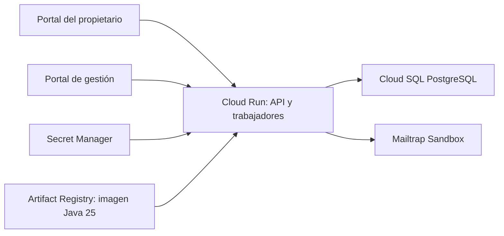

# Plan de entrega: procesos 1 y 2 y backend en Google Cloud

Fecha de planificación: **9 de octubre de 2026**, `America/Bogota`. Fecha objetivo confirmada: **18 de octubre de 2026**.

**Alcance confirmado por Esteban:** entregar registro/gestión de usuarios y mascotas y gestión de citas veterinarias, con backend desplegado en Google Cloud. La atención veterinaria y gestión clínica, proceso 3, quedan fuera de esta entrega. La URL del frontend se configurará mediante entorno cuando los compañeros la proporcionen.

**Registro de la fase de planificación.** En esa fase se consultaron código, documentos, Jira y documentación oficial; se ejecutó `git fetch --no-tags origin` y se escribió únicamente este plan, sin implementar ni publicar. Esteban autorizó después la implementación. El [informe del incremento 0.9.0](verificacion-procesos-1-2-preparacion-google-cloud-2026-10-09.md) registra el resultado posterior y sus límites; las tablas de punto de partida de este plan son históricas.

## 1. Punto de partida verificado

| Frente | Evidencia y límite |
|---|---|
| Repositorio | `C:/Users/ASUS/Documents/ChatGPT/GrownupsVet/grownupsvet-backend`, independiente de la carpeta padre |
| Rama / remoto | `main` / `origin/main`; remoto `https://github.com/Estebangmz666/grownupsvet-backend.git` |
| Estado tras fetch | Ambos en `dffff9cc2d49ab6eaafd22ac7cab0ffba6870704`; cero commits exclusivos; árbol limpio antes de este plan |
| Backend existente | Usuarios, acceso/perfil/sesión, mascotas, recuperación, personal/invitaciones, disponibilidad, citas, P07 y avisos excepcionales |
| Contrato publicado | OpenAPI 3.1.0, aplicación 0.8.0, 58 operaciones/39 rutas |
| Evidencia previa | [Informe P07](verificacion-cambios-citas-2026-10-08.md): 462 pruebas y 37 respuestas HTTP validadas, reejecutadas el 09/10. No se volvieron a ejecutar en esta planificación |
| Google Cloud | Esteban confirmó que no tiene infraestructura preparada ni experiencia previa. Cuenta, proyecto, facturación, créditos y permisos todavía no se verificaron |
| Herramientas locales | `docker.exe` encontrado; motor Docker no comprobado. `gcloud` no encontrado en PATH; no se instaló ni autenticó |
| Frontends | Jira los mantiene pendientes de integración/validación; no se inspeccionaron sus repositorios ni se conoce su avance real |

Se contrastaron el [README](../README.md), [citas](citas-y-agenda.md), [personal](personal-e-invitaciones.md), [recuperación](mascotas-y-recuperacion.md), [permisos](arquitectura-usuarios-y-permisos.md), [OpenAPI](openapi/README.md), el [plan anterior](plan-implementacion-2026-10-08.md), código/configuración pertinente y Jira en vivo. Los sprints y fechas anteriores de noviembre son históricos para esta entrega; no se cambiaron silenciosamente en Jira.

## 2. Entrega requerida y límites

**Proceso 1:** registro/login, perfil y sesión, mascotas, recuperación y personal/invitaciones, con permisos y datos persistidos. **Proceso 2:** disponibilidad, solicitud/confirmación/rechazo, agenda/historial, cancelación/reprogramación/inasistencia y avisos de citas. Backend, ambos portales, revisión, pruebas y evidencia deben distinguirse: publicar una API no completa por sí solo los procesos integrados.

Para el 18 no se implementarán clínica, fórmulas, tratamientos, historial clínico, adendas ni recordatorios de medicamentos/controles. Tampoco autoservicio de cambios, WhatsApp integrado, múltiples sedes, cambios de tecnología o plantillas visuales Thymeleaf. No se añade un estado de atención clínica completada para aparentar proceso 3.

Se mantiene Java 25, Spring Boot 4.1.1, PostgreSQL, monolito por dominios, JWT RS256, Flyway y contrato generado desde Java. No rehacer P1/P07 ya publicados. Las nuevas necesidades son P12 y preparación/operación en nube, incluida la fiabilidad del correo existente al reiniciar.

## 3. Reglas respondidas en esta conversación

| Decisión | Acuerdo confirmado |
|---|---|
| Canal y evidencia | Conservar **Mailtrap Sandbox**. Mensajes capturados allí son suficientes para la entrega académica; no afirmar llegada a un buzón real |
| Avisos al propietario | Confirmación, rechazo, cancelación manual o por corte y cambio de horario; se conservan avisos excepcionales de reasignación. Sin correo de inasistencia ni WhatsApp |
| Recordatorio | Para citas `CONFIRMED`, **24 horas antes** del inicio. Una intención de recordatorio por programación vigente; reintentos técnicos no son nuevos recordatorios |
| Confirmación tardía | Si se confirma cuando faltan menos de 24 horas, enviar confirmación y **omitir el recordatorio atrasado**. En la frontera exacta de 24 horas sí corresponde programarlo |
| Propietario desactivado | Seguir informando cambios y conservar el recordatorio de sus citas confirmadas vigentes; ambas reglas fueron respondidas expresamente. Desactivar acceso no cancela citas ni equivale a eliminar el destinatario |
| Corte diario | `APPOINTMENT_WORKDAY_START_TIME=06:00`, en `America/Bogota` |
| Frontend | URL suministrada después y modificable por variables de entorno; no codificar una URL real/ficticia dentro de servicios |

Se conservan las reglas P07: administración exclusiva, motivo, acuerdo previo, versiones e idempotencia; cancelación y reprogramación antes del inicio original; inasistencia desde el fin; destino general desde mañana hasta 60 días; una pendiente vencida no recupera vigencia. `SUPER_ADMIN` no hereda agenda.

### 3.1 Comportamiento previsto de P12

- Cada cambio efectivo guarda evento y tarea durable en la misma transacción. Un replay no genera otra tarea. El envío SMTP sucede después del commit y fuera de la transacción de cita.
- El recordatorio se calcula sobre instantes: inicio menos 24 horas; el texto muestra fecha/hora de Colombia. Reprogramar/reasignar invalida los pendientes del horario anterior y recalcula el nuevo, solo si el momento aún no pasó. Si ya pasó, el correo del cambio sustituye la necesidad de un recordatorio retroactivo.
- Una tarea ya programada que quedó vencida por una interrupción puede recuperarse mientras la cita siga confirmada y no haya comenzado. Al comenzar, cancelarse/rechazarse o cambiar de programación, deja de ser elegible. No crear tareas antiguas para todas las citas históricas al arrancar.
- La desactivación del propietario no suprime el aviso de un cambio administrativo de su cita. El recordatorio exige cita confirmada vigente; no se debe reutilizar como autorización el estado de la cuenta del destinatario. Las cuotas de recuperación y acceso conservan sus reglas propias.
- Conservar la revalidación inmediatamente antes de SMTP, leases/tokens, reintentos acotados y exclusión del worker vencido. Un evento nuevo puede superar un aviso viejo. Usar la revisión relevante de programación, no la versión global: un acceso auditado al correo también incrementa versión.
- `SENT` significa aceptación SMTP, no lectura ni recepción en buzón. No prometer entrega exactamente una vez ante una respuesta SMTP incierta. La no duplicación se verifica sobre intención/evento/tarea persistida.
- El mensaje usa datos mínimos: mascota, acción, profesional y fecha/hora vigentes; sin claves, tokens, diagnósticos ni notas internas. Texto claro en español; enlaces solo cuando haya frontend configurado. No exponer el correo del propietario mediante consultas de estado.

## 4. Prioridades y seguimiento Jira

La tabla refleja la consulta del 09/10; las fechas son las registradas en Jira, no el calendario propuesto abajo.

| Frente | Tareas y responsable | Estado / vencimiento | Pendiente para esta entrega |
|---|---|---|---|
| P12 backend/contrato | [SCRUM-47](https://uqvirtual-team-yavszk8l.atlassian.net/browse/SCRUM-47), [81](https://uqvirtual-team-yavszk8l.atlassian.net/browse/SCRUM-81), Esteban; historia [15](https://uqvirtual-team-yavszk8l.atlassian.net/browse/SCRUM-15) | 47/81 En curso, 13/10 y 07/10; 15 Por iniciar, 14/10 | Avisos/recordatorio acordados, persistencia, estado visible y contrato/revisión |
| Base de frontends | [SCRUM-75](https://uqvirtual-team-yavszk8l.atlassian.net/browse/SCRUM-75), Juan José | Por iniciar; 10/09 | Confirmar avance real y terminar estructura de ambos portales |
| Propietario P1 | [SCRUM-6](https://uqvirtual-team-yavszk8l.atlassian.net/browse/SCRUM-6), [7](https://uqvirtual-team-yavszk8l.atlassian.net/browse/SCRUM-7), [9](https://uqvirtual-team-yavszk8l.atlassian.net/browse/SCRUM-9), Juan José | En curso; fechas 15/09, 20/09, 24/09 | Integración de registro/perfil/mascotas/recuperación; interfaces 24/28/31 y validaciones compartidas 26/29/32 |
| Gestión P1/disponibilidad | [SCRUM-10](https://uqvirtual-team-yavszk8l.atlassian.net/browse/SCRUM-10), [11](https://uqvirtual-team-yavszk8l.atlassian.net/browse/SCRUM-11), Juan Manuel | Por iniciar; 27/09 y 04/10 | Acceso/sesión de gestión 25, interfaces 34/37 y validaciones 35/38; backend 33/36 Finalizado |
| P06/revisión | [SCRUM-79](https://uqvirtual-team-yavszk8l.atlassian.net/browse/SCRUM-79), [12](https://uqvirtual-team-yavszk8l.atlassian.net/browse/SCRUM-12), Esteban | En revisión / En curso; 02/10 y 08/10 | Revisión con tres integrantes y portales 40/41; validación 42; backend 39 Finalizado |
| P07 integración | [SCRUM-13](https://uqvirtual-team-yavszk8l.atlassian.net/browse/SCRUM-13), Juan Manuel; 44/45/46 | En curso; 12/10 | Backend 43 Finalizado y publicado. Propietario consulta resultados; administración gestiona cambios |
| P12 interfaz/pruebas | [SCRUM-48](https://uqvirtual-team-yavszk8l.atlassian.net/browse/SCRUM-48), [49](https://uqvirtual-team-yavszk8l.atlassian.net/browse/SCRUM-49), Juan José / Juan Manuel | Por iniciar; 13/10 y 14/10 | Consumo de avisos/estados, reinicio, repetición e invalidación |
| Demostraciones integradas | [SCRUM-77](https://uqvirtual-team-yavszk8l.atlassian.net/browse/SCRUM-77), [80](https://uqvirtual-team-yavszk8l.atlassian.net/browse/SCRUM-80), Juan Manuel / Juan José | Por iniciar; 20/09 y 04/10 | Evidencia P1/P2, revisión de recuperación, personal, horarios y accesibilidad |
| Google Cloud | Seguimiento específico por proponer para Esteban | No se encontró tarea que acredite este despliegue | Cuenta/proyecto, contenedor, DB, secretos, HTTPS, workers y prueba externa |

SCRUM-74 Finalizado acredita arranque/configuración local, no despliegue en Google Cloud. SCRUM-68 y SCRUM-86 exigen versión/revisión de **tres procesos** para noviembre: no reutilizarlas ni cerrarlas como si la entrega de dos procesos satisficiera todo su alcance. Las tareas clínicas se conservan para después. Cualquier creación, cambio de fechas/criterios o comentarios se propondrá y registrará en una fase autorizada, no en esta planificación.

## 5. Variables de frontend y configuración de nube

### 5.1 Diseño de URL y CORS

**`FRONTEND_BASE_URL` es una variable nueva propuesta**, para la base del portal del propietario y enlaces de sus correos. **`CORS_ALLOWED_ORIGINS` es otra propuesta**, lista explícita de orígenes de los dos portales, que pueden tener dominios diferentes. Conservar **`STAFF_ACTIVATION_URL`**, ya existente, como URL completa del formulario de activación del portal de gestión; no inventar la ruta que implementará Juan Manuel.

Cuando no se haya entregado la URL del frontend:

- El backend debe poder arrancar y publicarse sin `FRONTEND_BASE_URL`. Los avisos serán texto con los datos de cita, sin un enlace roto.
- Si no hay orígenes configurados, CORS queda cerrado a navegadores de otros orígenes; la API, Swagger del propio backend y pruebas directas siguen disponibles. No usar `*` como sustituto.
- Invitaciones pueden permanecer deshabilitadas en un primer despliegue técnico si falta la URL real de su formulario; **eso no acredita P1 completo**. Antes de la aceptación final se debe configurar y probar activación, o disponer del recorrido acordado de su interfaz.
- En el perfil de nube, al habilitar invitaciones, rechazar `example.invalid` y otros placeholders; no enviar enlaces que aparenten estar listos.

Cuando se reciban las URLs, validar HTTPS y ausencia de credenciales/query/fragmento; la base del portal puede conservar el prefijo de ruta acordado, pero cada origen CORS solo incluye esquema/host/puerto, sin rutas. CORS debe aceptar solo los orígenes exactos; preflight se resuelve antes de JWT y se permiten los métodos/encabezados realmente utilizados, incluido `Authorization`. No hacen falta cookies ni credenciales CORS. Una modificación de variables crea una revisión Cloud Run, **sin editar código ni reconstruir la imagen**. [Configuración oficial de variables](https://docs.cloud.google.com/run/docs/configuring/services/environment-variables).

### 5.2 Matriz de configuración

| Variable / recurso | Existencia | Uso previsto |
|---|---|---|
| `FRONTEND_BASE_URL` | Nueva propuesta | Enlaces opcionales de avisos al portal del propietario; inicialmente vacío |
| `CORS_ALLOWED_ORIGINS` | Nueva propuesta | Orígenes exactos de ambos portales; inicialmente vacío y sin wildcard |
| `STAFF_ACTIVATION_URL` | Existente | Formulario real de activación; eliminar placeholder de la configuración habilitada |
| `APPOINTMENT_WORKDAY_START_TIME` | Existente | **06:00**, zona `America/Bogota` |
| `SPRING_PROFILES_ACTIVE` | Convención Spring | Activar explícitamente `prod`; no heredar el perfil local `dev` |
| `PORT` | Suministrada por Cloud Run | Puerto de escucha, con 8080 para ejecución local/contenedor; escuchar en `0.0.0.0` |
| `SPRING_DATASOURCE_URL`, `DB_USERNAME`, `DB_PASSWORD` | Overrides Spring y variables existentes | Destino Cloud SQL y credenciales; no usar `DB_URL`, retirada |
| `CLOUD_SQL_INSTANCE_CONNECTION_NAME` | Nueva propuesta de despliegue | Identificar la instancia para el conector Java; verificar integración exacta al implementar |
| `JWT_KEYSTORE_PATH`, `JWT_KEYSTORE_PASSWORD`, `JWT_KEY_ALIAS`, `JWT_KEY_PASSWORD` si difiere | Existentes | PKCS12 montado en ruta Linux, contraseña/alias estables; conservar emisor/audiencia |
| `MAIL_HOST`, `MAIL_PORT`, `MAIL_USERNAME`, `MAIL_PASSWORD`, `MAIL_FROM` | Existentes | **Mailtrap Sandbox**, STARTTLS y timeouts; configurar en `prod`, no heredarlo accidentalmente de `dev` |
| `PASSWORD_RECOVERY_ENABLED`, `PASSWORD_RECOVERY_HMAC_SECRET` | Existentes | Recuperación habilitada para el cierre P1; conservar vencimientos, cuotas, revocación y uso único |
| `PASSWORD_RECOVERY_EMAIL_ENCRYPTION_KEY` | Nueva propuesta | Cifrar payload de correo durable, separado del HMAC de desafíos |
| `STAFF_INVITATIONS_ENABLED`, `STAFF_INVITATION_ENCRYPTION_KEY` | Existentes | Invitaciones habilitadas cuando configuración/formulario estén listos |
| `SUPER_ADMIN_BOOTSTRAP_ENABLED`, `SUPER_ADMIN_EMAIL`, `SUPER_ADMIN_PASSWORD` | Existentes | Aprovisionamiento inicial controlado; después deshabilitar bootstrap y retirar contraseña inicial del entorno |
| `APPOINTMENT_REMINDER_ADVANCE` | Nueva propuesta | Duración `PT24H`; se configura y valida, sin cambiar silenciosamente el acuerdo de 24 horas |

ID de proyecto, región, nombre de servicio/registro/instancia y presupuesto son parámetros de despliegue todavía sin valores reales, no secretos ni identificadores que deban inventarse. Claves, contraseñas y tokens se gestionarán fuera del repositorio. El perfil de nube debe fallar al arrancar si falta configuración indispensable de una funcionalidad habilitada; no consumir intentos de correo porque SMTP está ausente.

## 6. Arquitectura Google Cloud propuesta

Se recomienda **Cloud Run + Cloud SQL PostgreSQL + Secret Manager + Artifact Registry**, con el monolito existente. Usar una región común, provisionalmente `us-central1`, pendiente de disponibilidad, precio y condiciones de la cuenta. La región física no cambia la zona de negocio `America/Bogota`. La recomendación es técnica; no hay recursos creados ni presupuesto aprobado.

| Componente | Preparación futura |
|---|---|
| Cloud Run | Segunda generación, facturación por instancia, mínimo 1 y máximo inicial 1 a nivel de servicio; candidato 1 vCPU/2 GiB y concurrencia baja, inicialmente 8, para medir |
| Cloud SQL | PostgreSQL compatible con las migraciones, preferentemente 18 si se confirma soporte en región; edición/capacidad pequeñas explícitamente seleccionadas tras cotizar; datos ficticios de demostración, sin copiar datos personales de desarrollo |
| Conexión DB | Conector oficial Cloud SQL Java y Hikari existente; cuenta de servicio con `roles/cloudsql.client`, sin llave JSON descargada. Pool candidato máximo 5/minimumIdle bajo, validando capacidad y revisiones solapadas |
| Secret Manager | Secretos versionados para DB, SMTP, HMAC, cifrado y PKCS12 como archivo. Montaje propuesto `/var/secrets/jwt/jwt-signing.p12`; comprobar tamaño y lectura con el usuario del contenedor |
| Artifact Registry | Imagen Linux `amd64`, compilación/runtime Java 25, JAR y ejecutable `java` para hijos PDF; tag/digest trazable al commit. No incorporar claves, `.env` ni logs de `target` |
| Acceso HTTPS | URL del servicio publicada para ambos portales; invocación pública en la capa Cloud Run conforme a política del proyecto, conservando JWT y permisos de Spring |
| Probes | Inicialmente verificar arranque TCP y luego HTTP/DB. Si se añade salud HTTP, identificarla como nueva y limitar salida a estado; `/actuator/health` no existe actualmente |
| Operación | Logs sin secretos, backup/restauración de DB, disponibilidad de workers sin peticiones y recuperación tras reinicio; no depender de archivos locales para estado durable |

**CPU y fondo:** corte y correos usan schedulers/threads, por lo que el modo predeterminado de CPU solo durante peticiones es insuficiente. Facturación por instancia más mínimo 1 permite su ejecución; una instancia todavía puede reiniciarse y debe recuperarse desde DB. [Facturación y ejecución de fondo](https://docs.cloud.google.com/run/docs/configuring/billing-settings), [mínimos](https://docs.cloud.google.com/run/docs/configuring/min-instances).

**Memoria/contenedor:** `DiplomaPdfValidator` crea hasta dos JVM hijas y temporales; el límite debe cubrir padre, hijos y escrituras. Las fotos/diplomas ya están en PostgreSQL `BYTEA`: no se necesita un bucket o disco persistente nuevo. Adaptar Spring a `PORT` y comprobar carga PDF desde el JAR Linux. [Contrato del contenedor](https://docs.cloud.google.com/run/docs/container-contract), [memoria](https://docs.cloud.google.com/run/docs/configuring/services/memory-limits).

**DB/secretos:** no introducir una URL Unix socket como si JDBC la soportara sin conector. Mantener migraciones y esquema validados; limitar privilegios al esquema de aplicación. Versionar secretos y conservar claves entre revisiones; una revisión anterior no deshace Flyway. [Cloud Run a PostgreSQL](https://docs.cloud.google.com/sql/docs/postgres/connect-run), [secretos de servicio](https://docs.cloud.google.com/run/docs/configuring/services/secrets).

### 6.1 Inicio desde cero y costo

1. Esteban inicia sesión en [Google Cloud Console](https://console.cloud.google.com/) con su cuenta y completa por sí mismo el registro/facturación que corresponda. No enviar tarjetas, contraseñas ni claves por chat.
2. Comprobar elegibilidad y créditos **en la cuenta real**, y registrar ID del proyecto. Google anuncia US$300 para clientes nuevos; no se asume que Esteban califique ni que todos los recursos sean gratuitos. [Oferta oficial](https://cloud.google.com/free).
3. Cotizar Cloud Run con instancia activa y Cloud SQL, más almacenamiento/backups, imágenes/build, secretos, logs y red. Definir presupuesto máximo antes de provisionar; no se inventa una cotización con recursos todavía sin elegir. [Calculadora](https://cloud.google.com/products/calculator), [Cloud SQL](https://cloud.google.com/sql/pricing).
4. Configurar alertas de consumo y revisar cualquier límite de gasto disponible en la cuenta; las alertas ordinarias no equivalen a un corte de gasto. Acordar disponibilidad después del 18, respaldos y cierre controlado de recursos. [Presupuestos](https://docs.cloud.google.com/billing/docs/how-to/budgets).
5. Preparar el camino de ejecución: en Windows, instalar/autenticar Google Cloud CLI en la cuenta de Esteban y comprobar el motor Docker; como alternativa, usar Cloud Shell/Cloud Build con instrucciones equivalentes, sin asumir que un script PowerShell funciona directamente en Bash. Después preparar APIs, cuenta de servicio, registro, DB y secretos. Elegir edición SQL conscientemente; no aceptar capacidad/edición grande por defecto solo por una oferta de prueba.

Cloud Run con mínimo 0 requeriría separar/adaptar los workers; Compute Engine requeriría operar VM, sistema y HTTPS. Son alternativas de contingencia si el presupuesto impide la propuesta, **no cambios ya acordados**. No apagar diariamente el servicio para ahorrar mientras se pretende demostrar corte/recordatorios operativos.

## 7. Diseño futuro y archivos afectados

Todos los nombres/rutas nuevos de esta sección son **propuestas**, no implementaciones existentes.

### A. Configuración y empaquetado

- Crear `src/main/resources/application-prod.yaml`, configuración de `PORT`, SMTP explícito, datasource de nube y pool acotado. Modificar `pom.xml` solo para el conector oficial y salud si se decide añadirla, verificando compatibilidad vigente.
- Ampliar `shared/configuration/SecurityConfiguration.java` con CORS y, si corresponde, salud mínima; proponer `FrontendConfigurationProperties` para validar URL/orígenes y no dispersar concatenaciones en servicios.
- Mantener `STAFF_ACTIVATION_URL` y endurecer validación de placeholder en nube. No hacer obligatoria una URL de frontend para arrancar una API aún sin consumidores; sí para habilitar operaciones que envíen enlaces de activación.
- Añadir `Dockerfile`, `.dockerignore`, guía de despliegue y script parametrizado, propuesto `scripts/deploy-google-cloud.ps1`. Construcción en varias etapas Java 25; ejecución con usuario sin privilegios y temporal escribible. No ejecutar infraestructura desde un test ni registrar secretos en línea de comandos/logs.
- Validar headers/IP detrás del proxy: recuperación usa `getRemoteAddr()` para cuotas. No aceptar ciegamente `X-Forwarded-For`; comprobar la cadena de proxy confiable del entorno elegido y aislamiento de cuotas entre clientes.

### B. P12 durable y estado visible

- Reutilizar `appointment_email_tasks`, `AppointmentEmailDispatcher`, `AppointmentNotificationsQueuedEvent`, `AppointmentService` y `AppointmentCutoffScheduler`. No construir otra cola/proveedor para citas.
- Extraer encolado/vigencia comunes si evita ampliar excesivamente `AppointmentService`; nombre propuesto `AppointmentNotificationService`. Los tipos nuevos propuestos son avisos de confirmación/rechazo/cancelación/reprogramación y recordatorio, conservando los excepcionales.
- Usar evento/revisión persistida como identidad de intención y la unicidad por evento/destinatario/tipo. La generación periódica de recordatorios debe ser idempotente, no crear UUID aleatorios nuevos en cada sondeo. Persistir una fecha programada original independiente de `next_attempt_at`: este último cambia por backoff y adquisición; la API no debe confundirlos. Conservar leases/reintentos.
- Adecuar vigencia para terminales: los correos de cancelación/rechazo no pueden usar el filtro actual que solo admite `REQUESTED`/`CONFIRMED`. No invalidarlos por estar correctamente en estado terminal.
- Proponer **`GET /api/v1/appointments/{appointmentId}/notifications`**, dentro de la estructura de citas ya validada, para estado paginado de avisos. Propietario: solo avisos de su cita destinados a él; administrador: seguimiento autorizado sin correos ni payloads privados; veterinario/superadministrador sin permiso nuevo. Reutilizar permisos de consulta pertinentes y guardas de propiedad.
- DTOs propuestos `AppointmentNotificationResponseDTO` y `AppointmentNotificationPageResponseDTO`: tipo, estado, fecha prevista/envío, intentos y código funcional público cuando sea útil. No devolver tokens, destinatario/email, texto interno SMTP o payload privado. P12 no necesita acciones de reenvío manual en esta entrega.
- Estados existentes `PENDING`, `SENDING`, `SENT`, `FAILED`, `SUPERSEDED`; la fecha prevista permite distinguir un pendiente futuro. La interfaz no anuncia una recepción real porque la entrega usa Sandbox.

### C. Recuperación: quitar dependencia de memoria

`authentication/recovery/service/PasswordRecoveryMailDispatcher.java` contiene actualmente una cola en memoria; `UserPasswordRecoveryService` la usa después del commit. Desafíos/cuotas son persistidos, pero un reinicio puede perder el correo. Debe resolverse para confiar en P1 sobre instancias reemplazables.

- Persistir la intención de correo de recuperación/restablecimiento dentro de la transacción correspondiente y despacharla tras commit, con recuperación periódica, adquisición y reintentos acotados. Reutilizar las convenciones de correo durable, no crear un broker externo.
- Conservar HMAC del desafío, OTP de seis dígitos/ceros iniciales, vencimientos actuales, cuotas, uso único, revocación y respuestas indistinguibles para cuentas inexistentes/inactivas. La admisión/capacidad y disponibilidad se comprueban de forma común antes de bifurcar por cuenta conocida/desconocida; un agotamiento no produce `503` únicamente para cuentas existentes.
- Si se guarda el código para reintentar SMTP, el payload debe estar **cifrado**, con clave propia estable de entorno/Secret Manager; no almacenar OTP en texto plano ni reemplazar el digest de validación por ese payload. Antes del envío verificar que el desafío siga vigente/no reemplazado; no enviar códigos expirados.
- El servicio actual invalida el desafío al primer fallo de entrega. Al introducir la outbox, no conservar esa invalidación para un error SMTP reintentable: solo finalizar por expiración, reemplazo, fallo terminal o agotamiento según política, usando el `challengeId` exacto. El fallo de una tarea antigua nunca puede eliminar un desafío nuevo.
- Los fallos de correo no revierten una contraseña ya restablecida. Proteger logs y purgar material sensible al dejar de ser necesario. No añadir rutas públicas de administración de esta cola.

### D. Persistencia, contrato y documentación

Conservar V1–V16. Proponer **V17** para ampliación P12 y **V18** para correo durable de recuperación, comprobando números libres al ejecutar. Describir CHECK, unicidad, estados y consultas necesarias; no editar migraciones aplicadas ni escribir SQL ejecutable durante este plan.

Proponer contrato **0.9.0**: DTOs/controladores/anotaciones Java, ejemplos HTTP reales, validador independiente, generación y snapshot solo después de comprobar. Las cantidades de operaciones/pruebas se medirán después; no anticipar que seguirán siendo 58/462. Actualizar guías de citas, recuperación, personal, configuración, cloud y evidencia; mantener separados código, pruebas, publicación, despliegue e integración.

## 8. Orden de trabajo y calendario propuesto

Las fechas son un orden de entrega, no estimaciones de horas ni garantía sin capacidad real. **Desplegar una primera revisión pronto**, sin esperar a terminar todos los frontends, reduce el riesgo del último día.

| Fecha objetivo | Trabajo | Resultado comprobable / dependencia |
|---|---|---|
| 10/10 | Crear cuenta/proyecto, verificar créditos/presupuesto; confirmar avance de ambos portales. Preparar perfil/env/CORS/contenedor | Identificadores reales, costo aceptado y backend empaquetable. No crear recursos facturables sin resolver presupuesto |
| 10–12/10 | P12: eventos, recordatorio, estado visible y persistencia; recuperación durable en paralelo por archivos separados | Backend funcional y pruebas de reinicio/errores/privacidad; preservar contratos anteriores |
| 12–13/10 | Primera revisión Google Cloud, Cloud SQL, secretos, Sandbox y CPU de fondo | URL HTTPS operativa, datos persistentes y trabajadores funcionando sin tráfico |
| 13–15/10 | Recibir URLs reales, configurar entorno y conectar ambos portales; revisar contrato | CORS/preflight correctos; activación/recuperación y agenda completas. Preparar una cita ficticia para comprobar recordatorio real al día siguiente |
| 15–16/10 | Recorridos P1/P2, permisos, accesibilidad, correo Sandbox, reinicio y respaldo/restauración | Evidencia integrada con los tres; bugs corregidos y entorno reproducible |
| 17/10 | Congelar alcance, revisión final, guion/documentación y ensayo | Dos procesos demostrables sobre la revisión final; contingencia preparada |
| 18/10 | Entrega/demostración | URL accesible, Sandbox disponible para evidencia, responsables y datos ficticios de prueba preparados |

Esteban: backend, contrato, datos y nube. Juan José: portal del propietario e integración/validación a su cargo. Juan Manuel: portal de gestión e integración/validación a su cargo. Conservar asignaciones Jira; no implementar módulos de compañeros sin autorización. Los compañeros pueden trabajar desde el contrato y mocks mientras se prepara la nube.

Tres incrementos revisables: **A configuración y primera revisión de nube; B P12/recuperación y contrato 0.9.0; C integración y cierre de los dos procesos**. P12 y preparación de nube pueden avanzar en paralelo; migraciones y despliegue final respetan sus dependencias. Si algún bloque no cabe, negociar un alcance explícito; no declarar completo un proceso con operaciones esenciales deshabilitadas.

## 9. Verificación y evidencia que se deberán producir

| Área | Escenarios mínimos |
|---|---|
| Avisos | Confirmar/rechazar/cancelar/reprogramar/corte; destinatario correcto; sin aviso de inasistencia; actor/intención repetidos no duplican tarea; propietario desactivado conserva información de cambios |
| Recordatorio | Confirmación antes/en/después de la frontera de 24 horas; omisión tardía; cambio de horario; cancelación; ninguna elegibilidad desde inicio; dos workers/sondeos; acceso auditado al correo no altera programación |
| Recuperación durable | OTP con ceros, desafío reemplazado/vencido, uso único concurrente, cuenta inactiva/inexistente indistinguibles, clave de cifrado, commit/rollback y reinicio antes de SMTP; contraseña nueva/antigua y JWT revocados |
| Workers | SMTP fuera de transacción de negocio, error/reintento, task superada, lease vencido/worker viejo, recuperación tras revisión/reinicio e inactividad HTTP |
| Frontend/env | URL vacía permite backend inicial sin enlaces rotos; cambio de URL sin rebuild; dos orígenes exactos, preflight, origen ajeno, JWT/permisos; activación habilitada rechaza placeholder |
| Nube | Puerto/escucha, credenciales y archivo PKCS12, DB/conector/pool, Flyway e identidad estable, PDF desde JAR Linux con dos hijos/memoria, persistencia de fotos/diplomas, proxy/IP y secretos ausentes |
| Integración P1 | Registro → login → mascota; perfil/archivo/recuperación; personal/invitación/activación; cuentas desactivadas, sesión/propiedad y errores |
| Integración P2 | Turno → solicitud → confirmación → agenda; rechazo/corte/liberación; cancelación/reprogramación/inasistencia; cambios exclusivamente administrativos e historial autorizado |
| Presentación | Teclado, foco/errores comprensibles, contraste/zoom y lectura de fechas; ausencia de éxito ante conflictos. Capturas/videos/guion de los dos portales con datos ficticios |

Durante implementación: pruebas focalizadas significativas, `.\mvnw.cmd verify`, validación independiente del OpenAPI/ejemplos, empaquetado/ejecución del contenedor y pruebas HTTP en HTTPS. No usar endpoints de prueba o un reloj manipulable públicamente en el despliegue. Simular fronteras con `Clock` en pruebas aisladas y programar un recordatorio real con tiempo suficiente entre el 13 y el 15.

Evidencia permanente: informe fechado con commit/revisión Cloud Run, migraciones, resultados medidos, pruebas de reinicio y backup/restauración, mensajes **capturados en Mailtrap**, revisión de los tres, casos integrados y pendientes. No publicar credenciales, OTP, claves, JWT reales ni datos personales en capturas/repositorio. Un rollback de aplicación se prueba contra el esquema compatible; no se deshacen migraciones borrando tablas.

## 10. Dependencias pendientes y condiciones de cierre

**Decisiones funcionales de esta entrega respondidas:** procesos 1/2, fecha, eventos/canal, 24 horas/confirmación tardía, Sandbox, propietario desactivado, corte 06:00 y URL por entorno. Los nombres nuevos y dimensionamiento cloud son propuestas técnicas concretas para implementar.

**Datos externos todavía faltantes:** cuenta/proyecto/facturación y créditos efectivos; presupuesto máximo para recursos y tiempo de disponibilidad tras el 18; URLs/orígenes/formulario de activación de los frontends y avance real de cada compañero. No se requieren las URLs para preparar código o un primer backend, pero sí para completar la integración/activación final. Antes de provisionar, resolver presupuesto y acceso reales, sin inventar esos valores.

**Cierre backend:** P1/P2 configurados y comprobados, P12 y recuperación durables, contrato generado/validado y evidencia; publicación confirmada cuando se autorice. **Cierre de nube:** URL HTTPS, PostgreSQL persistente, secretos correctos, workers sin tráfico/reinicio, PDF y SMTP Sandbox comprobados. **Cierre de dos procesos:** ambos portales integrados, revisión/validación compartida, permisos, accesibilidad pertinente, guion y evidencia del alcance confirmado.

Jira: proponer tareas/subtareas específicas de despliegue y recuperación durable; registrar reglas P12 respondidas y evidencia en 15/47/48/49/81. Completar SCRUM-81 solo tras P12 y revisión de los tres, y las historias únicamente tras integración/aceptación. Registrar que el 18 se entregan dos procesos; no marcar tareas de clínica o revisión de tres procesos como completas.

**Condición de parada de la planificación original:** entregar este plan, sin ejecutarlo ni publicar. La autorización posterior de implementación permite desarrollar y verificar el incremento; proyecto, presupuesto e infraestructura de nube aún requieren datos reales, y su preparación local no acredita un despliegue.
