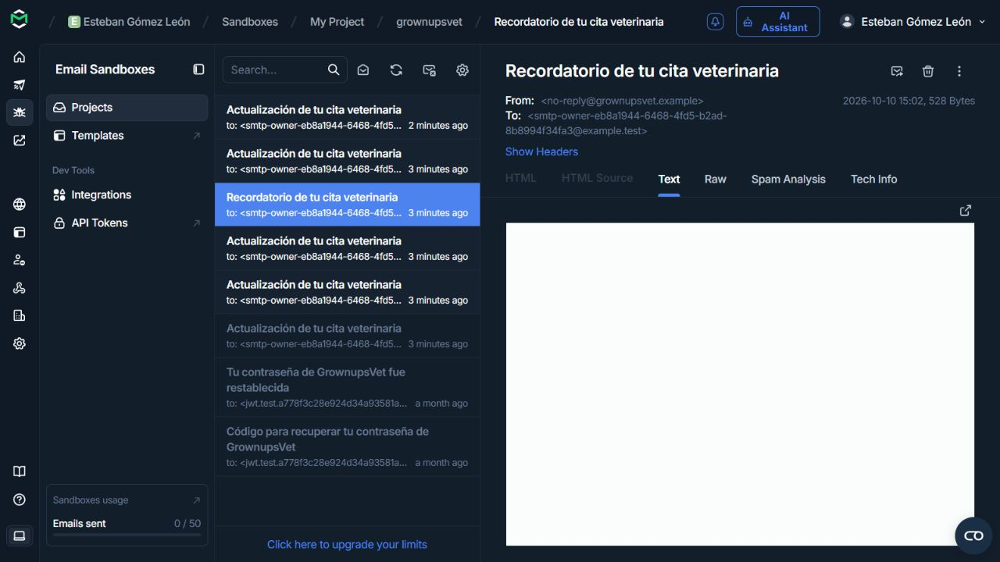
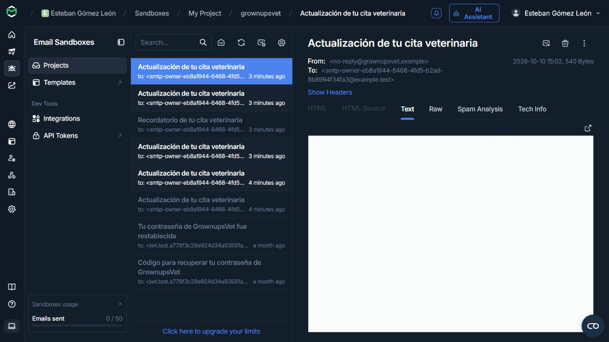

# Verificación de avisos de citas en Mailtrap Sandbox

Fecha: **10 de octubre de 2026**. Backend **0.9.0**, revisión `4f0f209f288e94ec014083d206ecc8dad68714c7`, ejecución aislada con datos ficticios y SMTP real hacia el Sandbox `grownupsvet`. La comprobación no cambió `src/main`.

Este informe conserva el alcance del primer ensayo. Después se ejecutaron el [recordatorio con reloj real](verificacion-recordatorio-real-2026-10-10.md) y el [transporte de recuperación V18](verificacion-recuperacion-smtp-2026-10-10.md), documentados por separado.

## Resultado comprobado

El harness terminó con **6 tareas `SENT`, un intento por tarea**, sobre 7 tareas persistidas. El recordatorio anterior a la reprogramación quedó `SUPERSEDED`, sin intentos. No quedaron tareas `PENDING`, `SENDING` o `FAILED` en ese recorrido.

En la bandeja autenticada de Mailtrap se observaron **6 mensajes nuevos** dirigidos a `smtp-owner-eb8a1944-6468-4fd5-b2ad-8b8994f34fa3@example.test`: cinco con asunto «Actualización de tu cita veterinaria» y uno con «Recordatorio de tu cita veterinaria». Las capturas conservan la lista y los encabezados de dos mensajes seleccionados.

**El contenido visual sigue pendiente:** las vistas Text/Raw mostraron el panel en blanco. El navegador rechazó abrir el recurso `blob` por su política; se respetó ese límite. Esta revisión acredita entradas y encabezados, sin comprobar visualmente el texto de mascota, profesional, horario o motivo dentro de cada mensaje. La correspondencia individual entre evento e ID de Mailtrap sería una inferencia del orden secuencial de envío, no una lectura del cuerpo.

## Método y fuentes

- `RunId`: `eb8a1944-6468-4fd5-b2ad-8b8994f34fa3`.
- Fuente local archivada: `target/mailtrap-smoke/report-eb8a1944-6468-4fd5-b2ad-8b8994f34fa3.json`. Su copia publicable es [reporte-harness.json](evidencia-mailtrap-2026-10-10/reporte-harness.json); excluye PID, URL local y nombres internos de esquemas.
- El harness levantó el backend usando PostgreSQL existente en un esquema temporal propio. Usó HTTP real y JWT válidos para registro, mascotas, disponibilidad y cambios de citas. Administrador/veterinario fueron fixtures; sus invitaciones y activación no se comprobaron.
- SMTP usó el Sandbox existente con autenticación y STARTTLS. La captura de esta ejecución ocurrió el **10/10**; las horas mostradas por la interfaz se transcriben más abajo. No se publican credenciales, contraseñas, claves ni JWT.
- Se comprobó el replay de confirmación: conservó la versión y no creó otra tarea de correo.
- Recuperación de contraseña estuvo deshabilitada en este harness. Los dos mensajes antiguos de recuperación del 10 de septiembre que aparecen al final de la bandeja no acreditan la recuperación del backend 0.9.0 actual.

Se usa el reporte archivado: el cierre del wrapper sobrescribió el archivo genérico `report.json`. `AWAITING_INBOX_VERIFICATION` corresponde al momento previo a observar la bandeja; este informe registra esa revisión posterior.

## Tareas persistidas

| Tipo | Evento / actor | Resultado | Intentos |
|---|---|---|---|
| `OWNER_CONFIRMED` | `CONFIRMED` / `HUMAN` | `SENT` | 1 |
| `OWNER_REJECTED` | `REJECTED` / `HUMAN` | `SENT` | 1 |
| `OWNER_RESCHEDULED` | `RESCHEDULED` / `HUMAN` | `SENT` | 1 |
| `OWNER_REMINDER` vigente | Programación de `RESCHEDULED` / `HUMAN` | `SENT` | 1 |
| `OWNER_CANCELLED` | `CANCELLED` / `HUMAN` | `SENT` | 1 |
| `OWNER_CANCELLED` | `DAILY_CUTOFF` / `SYSTEM` | `SENT` | 1 |

La séptima tarea, el recordatorio de la confirmación anterior, quedó `SUPERSEDED` con 0 intentos. Los UUID y fechas están en la copia del reporte. `SENT` acredita aceptación SMTP; la observación de bandeja es evidencia adicional y no significa lectura ni recepción en un buzón externo.

## Recordatorio y corte: reloj privado simulado

Se conservó `PT24H` y la jornada de corte de las **06:00 en `America/Bogota`**. Se avanzó únicamente el `Clock` privado del contexto de prueba; el reloj del sistema y la configuración productiva permanecieron intactos.

| Momento de negocio | Instante usado por el reloj privado | Acción |
|---|---|---|
| Inicial | 10/10/2026 10:01:32 Colombia | Confirmación, rechazo y reprogramación |
| Inicio menos 24 horas | 11/10/2026 14:00 Colombia | Despacho explícito del recordatorio de la cita reprogramada para 12/10 a las 14:00 |
| Corte almacenado | 12/10/2026 06:00 Colombia | Ejecución explícita del corte sobre una cita pendiente; evento `DAILY_CUTOFF`, actor `SYSTEM` |

Las fechas `scheduled_at` y `sent_at` del reporte proceden de ese reloj privado; no representan la hora real de recepción en Mailtrap. Esta ejecución comprueba la condición temporal y el envío real, **sin esperar 24 horas reales**. La observación del trabajador periódico con reloj real pertenece al ensayo posterior enlazado arriba.

## Bandeja y capturas

Los seis IDs observados fueron `5747380291`, `5747380512`, `5747380737`, `5747380989`, `5747381241` y `5747381433`. El ID `5747380989` mostró el asunto de recordatorio; los otros cinco mostraron el de actualización.

En los encabezados seleccionados se leyó: primer aviso, `2026-10-10 15:01`, 541 bytes; recordatorio, `2026-10-10 15:02`, 528 bytes; último aviso, `2026-10-10 15:02`, 540 bytes. Estas horas se transcriben como aparecieron en la interfaz; **su zona horaria no fue verificada**.

## Limpieza y límites pendientes

La comprobación independiente de limpieza confirmó que el proceso terminó, su puerto quedó cerrado y los esquemas temporales propios del harness y del wrapper ya no existían. No se prepararon datos persistentes en `grownupsvet_dev`.

Quedan pendientes la lectura visual del contenido, el flujo real completo de OTP/restablecimiento, integración de ambos portales y revisión compartida. El recordatorio con reloj real y el transporte de recuperación tienen evidencia posterior independiente. El despliegue permanece aplazado y la atención clínica queda fuera. Estas evidencias no cierran P12 ni la aceptación de los dos procesos.

El [helper de datos](datos-demostracion.md) conserva `MailtrapCaptureVerified=false`: su prueba aislada y su reporte no inspeccionan el Sandbox. La evidencia de esta ejecución SMTP pertenece a este informe separado. Para completar los recorridos manuales, seguir [verificacion-mailtrap.md](verificacion-mailtrap.md).
